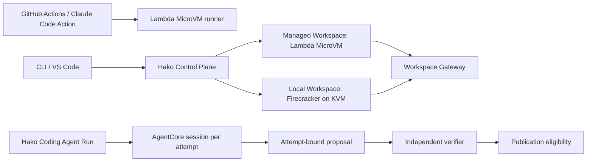

# Hako Execution Architecture

Status: Local contracts and most fake-provider acceptance are implemented.
AWS deployment, provider isolation, and staging acceptance remain explicit
release gates as listed in the task board.

Implementation status and the document reading order are summarized in
[implementation summary](implementation-summary.md).

## Runtime placement

Hako routes each kind of work to the runtime that matches its lifetime and
interaction model. Runtime selection is part of trusted deployment
configuration; repository content and user supplied queue messages cannot
select a provider, Runtime, Region, execution role, or session.

| Workload | Execution target | Lifecycle | Acceptance boundary |
| --- | --- | --- | --- |
| Standard GitHub Actions job | Ephemeral runner on Lambda MicroVM | One runner per accepted job; report Check/result, then deregister and terminate | Local fake-provider and PostgreSQL lifecycle tests pass; AWS ARM64 image, networking, and deployment acceptance remain gated |
| Approved Claude Code Action | Same Lambda MicroVM runner, with workflow provenance and Tenant model-credential policy | One-shot workflow execution; credential restricted to approved repository/workflow/job; cleanup follows job completion | Local admission, credential, runner and lifecycle tests pass; deployed IAM and workflow smoke remain gated |
| Hako Coding Agent Run | Amazon Bedrock AgentCore Runtime | One opaque Runtime session per immutable attempt; attempt-bound source and proposal; independently verify before publication; stop session before terminal publication | Local Python/Go contracts, fake-provider worker tests, AWS SDK adapter and default-off Lambda composition exist; heartbeat, independent verification, Runtime image and deployed isolation/cleanup remain gated |
| Interactive Workspace | Lambda MicroVM in managed deployments; optional Firecracker/KVM on one Linux host | Durable Workspace journal and persistent `/workspace`; Gateway issues short-lived session tickets and routes streams to the Guest Agent | Managed Lambda path awaits AWS staging acceptance. Local Firecracker driver, operation API, Gateway route and worker are implemented; complete CLI/Gateway lifecycle smoke remains open |

## Ownership and trust boundaries

- The Control Plane owns Tenant authorization, Workspace and Run state,
  immutable operation/attempt identity, and the decision to issue session
  tickets or publish a verified proposal.
- A Resource Plane owns runtime-specific infrastructure and dispatch. Runtime
  IDs, Regions, roles, images and provider targets come from trusted deployment
  configuration and durable Hako journals.
- A MicroVM or AgentCore session executes untrusted repository/workflow code.
  Runtime isolation does not authorize access to Tenant credentials or Hako
  records. Keep GitHub write credentials and broad AWS access outside the
  workload environment; use narrow, short-lived broker APIs where required.
- The Workspace Gateway verifies Hako Session tickets, checks current
  authorization, then routes the stream to the bound Guest Agent. The Guest
  verifies its own short-lived signed Agent ticket. Shell, exec, file, VS Code,
  SSH, and port operations share this authorization boundary.
- Coding Agent proposal bytes are drafts. Hako binds them to immutable attempt
  and source pins, independently applies and verifies them, and only then makes
  publication eligible. A Runtime response cannot assert verification.

## Lifecycle invariants

1. Persist the operation or attempt identity before provider side effects.
   Retries reuse that identity and the frozen launch or invocation request.
2. Treat timeouts after a side effect as ambiguous. Reconcile the existing
   allocation/session; do not create a replacement or invoke the same coding
   attempt again without authoritative evidence.
3. Record terminal provider cleanup before publishing terminal results. Cleanup
   failures stay retryable and visible to reconciliation.
4. Workspace suspend keeps its persistent data disk; resume boots the same
   allocation identity or data disk. Delete writes a tombstone before provider
   cleanup and reports completion only after cleanup is observed.
5. An unavailable or disabled provider fails closed. Coding Agent work never
   falls back from AgentCore to Lambda MicroVM.

## Local development

The local Workspace profile uses PostgreSQL, a loopback-only OAuth/JWKS test
provider, normal Control Plane authorization, local Ed25519 Session signing,
Plane-fenced HMAC lookup/lease keys, an Outbox worker, a private Unix socket
Controller, Firecracker on `/dev/kvm`, and the AWS-free Gateway
`firecracker-local` mode. HTTPS remains enabled with a locally trusted
certificate. The identity provider is for one-user local development only.

The real-KVM smoke verifies Firecracker ensure, orderly Guest shutdown, cold
resume from the same ext4 disk, fixed-port vsock health, and delete. The local
authenticated CLI/API path also reaches a real Guest and completes create,
running, and delete. A 2026-11-23 composed smoke found that shell has no visible
prompt/output, exec cannot start commands, and file upload fails, so the
interactive route is not accepted yet. VS Code browser, SSH, Workspace file
persistence, and controller restart/retry remain unverified. Follow
the [local Workspace MicroVM runbook](local-workspace-microvm.md) and status in
[Task 98](../tasks/task-98-local-workspace-microvm.md).

## Detailed specifications

- [AgentCore topology, request contract, lifecycle, and deployment gates](agentcore-runtime-placement.md)
- [Coding Agent platform and routing](coding-agent-platform.md)
- [Coding Agent isolation and credentials](coding-agent-isolation-and-credentials.md)
- [Lambda MicroVM Workspace contract](workspace-lambda-microvm.md)
- [Workspace CLI and Gateway behavior](workspace-cli.md)
- [Workspace session and stream authorization](workspace-gateway.md)
- [Local KVM/Firecracker Workspace runbook](local-workspace-microvm.md)
- [Managed runtime staging acceptance](software-factory-aws-smoke.md)
- [Implementation task board](../tasks/README.md)

## Acceptance status

Local unit, race, fake-provider, and PostgreSQL acceptance is recorded per
component and task. It does not prove AWS IAM, networking, deployed image
contents, provider quotas, costs, or cleanup behavior. Managed-runtime release
acceptance remains tracked by [Task 99](../tasks/task-99-managed-runtime-acceptance.md)
and must run in the approved staging account. The local Workspace profile is
independent of AWS and remains open until its end-to-end CLI/Gateway acceptance
passes.
